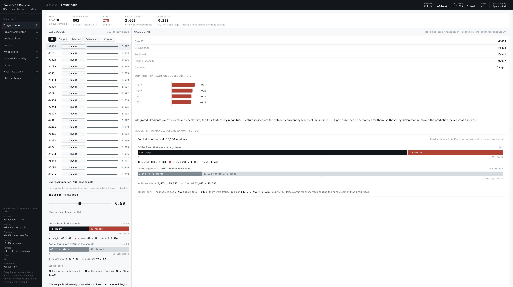
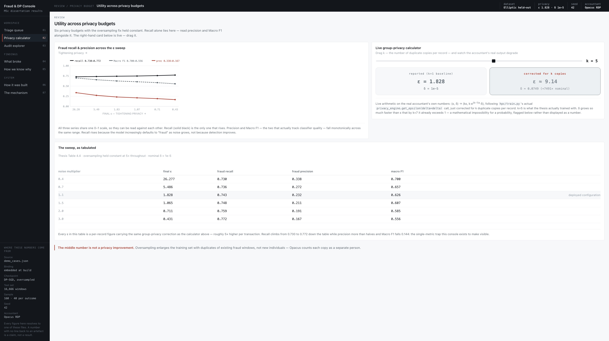

# Privacy-Preserving Fraud Detection

**MSc Data Science and Advanced Computing dissertation project · University of Reading**  
Yassine Malal · Supervisor: Dr. Xiaomin Chen

A GRU-based fraud detector evaluated with and without differentially private training. The project measures what DP-SGD changes for minority-class detection on the Elliptic Bitcoin transaction dataset and tests the finding again on PaySim. It includes the training code, saved experiment results and checkpoints, and an interactive results console that opens offline.

> **[Open the live results console](https://yass149.github.io/privacy-preserving-fraud-detection/)**, or download this repository and open [`dashboard/index.html`](dashboard/index.html) in a browser. The downloaded version needs no server, Python environment, or network connection.

## Screenshots

The console lets you inspect held-out cases, change the decision threshold, compare privacy budgets, and audit the reported privacy guarantee.

[](assets/screenshots/triage-queue.png)
*Fraud triage: case-level scores and explanations beside full test-set outcomes.*

[](assets/screenshots/privacy-calculator.png)
*Privacy calculator: the noise sweep and the effect of duplicating minority-class records.*

## The main finding

Standard class weighting stopped working when DP-SGD clipped gradients per training example. The model still ranked fraud cases above chance, but its default decision threshold classified every fraud case as safe. Oversampling the fraud class restored recall, while creating a weaker transaction-level privacy guarantee than the reported per-record ε suggests.

| Elliptic experiment | Fraud recall | Fraud precision | Reported ε |
| --- | ---: | ---: | ---: |
| Non-private baseline | 0.727 | 0.323 | — |
| DP-SGD with class weighting | 0.000 | 0.000 | 2.274 |
| DP-SGD with 5× fraud oversampling | 0.743 | 0.232 | 1.828 |

These values come from [`results/metrics/`](results/metrics/) and use the same 16,666-window held-out test set. The 5× oversampled run's ε = 1.828 is **per training record**. A fraud window appears five times, so a transaction-level group-privacy bound is approximately ε = 9.14, with a substantially larger δ. The oversampling run improves detection; it should not be presented as a privacy improvement over the class-weighted run. The console also shows the precision cost: 803 fraud cases caught alongside 2,663 false alarms.

Controls vary class weighting and clipping norm; a class-stratified membership-inference audit examines leakage separately for fraud and safe transactions. PaySim provides a second, structurally different dataset for generalisation. See the console's **What broke**, **How we know why**, and **Audit explorer** panels for the evidence and caveats.

## Quick start

### Offline results console (recommended)

1. Clone or download this repository.
2. Open `dashboard/index.html` in a desktop browser.
3. Use the left navigation to explore the seven panels. The triage queue and privacy calculator are interactive.

The HTML contains the data needed for the demo. Its numbers were built from the committed JSON artifacts; opening it does not train or load a model.

### Streamlit dashboard (earlier interface)

The older Streamlit app remains available for exploring the results locally:

```bash
python -m venv .venv
source .venv/bin/activate  # Windows: .venv\Scripts\activate
pip install -r requirements-dashboard.txt
streamlit run app.py
```

`app.py` reads precomputed results and demo cases. It does not run model inference and needs no GPU. The standalone HTML console is the recommended presentation interface.

### Run the tests

```bash
pip install pytest numpy pandas
pip install torch --index-url https://download.pytorch.org/whl/cpu
python -m pytest -q
```

The current code-and-artifact suite passes 36 tests. Another 17 thesis-dependent checks skip because the dissertation source is intentionally absent from this repository. GitHub Actions runs the same CPU-only suite on pushes and pull requests.

## Reproduce the experiments

Training is designed for a GPU-equipped SLURM cluster with PyTorch, RAPIDS/cuDF, and Opacus. See [`requirements-hpc.txt`](requirements-hpc.txt) for the environment. The raw datasets are **not redistributed** here. Obtain them from their respective sources and update the input paths documented in the `hpc/` scripts before running.

```bash
# Elliptic baseline
python hpc/train_baseline.py --epochs 5 --minority_oversample_factor 1.0

# Elliptic DP-SGD with the 5× oversampling configuration
python hpc/train.py --noise_multiplier 1.1 --max_grad_norm 1.0 \
  --minority_oversample_factor 5.0 --tag oversampled

# PaySim generalisation run
python hpc/train_paysim.py --dp --noise_multiplier 1.1 \
  --minority_oversample_factor 200.0
```

The training scripts have additional flags and safeguards against overwriting existing outputs; use `--help` for details. `hpc/` is self-contained for cluster deployment, while [`paths.py`](paths.py) resolves artifact locations for the local code. Some historical checkpoints predate full seeding, so the committed checkpoints preserve the provenance of the reported runs even where bit-for-bit retraining is unavailable.

## Repository map

| Path | Purpose |
| --- | --- |
| [`dashboard/index.html`](dashboard/index.html) | Standalone, offline results console |
| [`app.py`](app.py) | Earlier Streamlit dashboard |
| [`hpc/`](hpc/) | Training, data loading, privacy audit, and scalability experiments for the cluster |
| [`src/`](src/) | Importable model, checkpoint loading, and prediction code |
| [`results/metrics/`](results/metrics/) | Experiment metrics used for reported comparisons |
| [`results/attacks/`](results/attacks/) | Membership-inference audit results |
| [`results/checkpoints/`](results/checkpoints/) | Saved model weights for reproducibility |
| [`results/demo_cases.json`](results/demo_cases.json) | Precomputed held-out examples for the dashboards |
| [`tests/`](tests/) | Code, artifact, and reproducibility checks |

## Data and scope

- **Elliptic:** Weber et al. (2019), [Elliptic Bitcoin transaction dataset](https://www.kaggle.com/datasets/ellipticco/elliptic-data-set).
- **PaySim:** López-Rojas, Elmir and Axelsson (2016), [synthetic mobile-money transactions](https://www.kaggle.com/datasets/ealaxi/paysim1).

The checkpoint and metrics files are provided so the results can be inspected without the original training environment. The raw datasets, dissertation, drafts, and university forms are not included. Elliptic's feature columns are anonymised, so the case explanations identify influential feature indices without assigning them real-world meanings. These experiments assess privacy and detection trade-offs; the console is a research demonstration, not a production fraud-screening service.

**Licence:** No reuse licence has been granted for this repository. Please contact the author before redistributing or adapting the code or artifacts.
